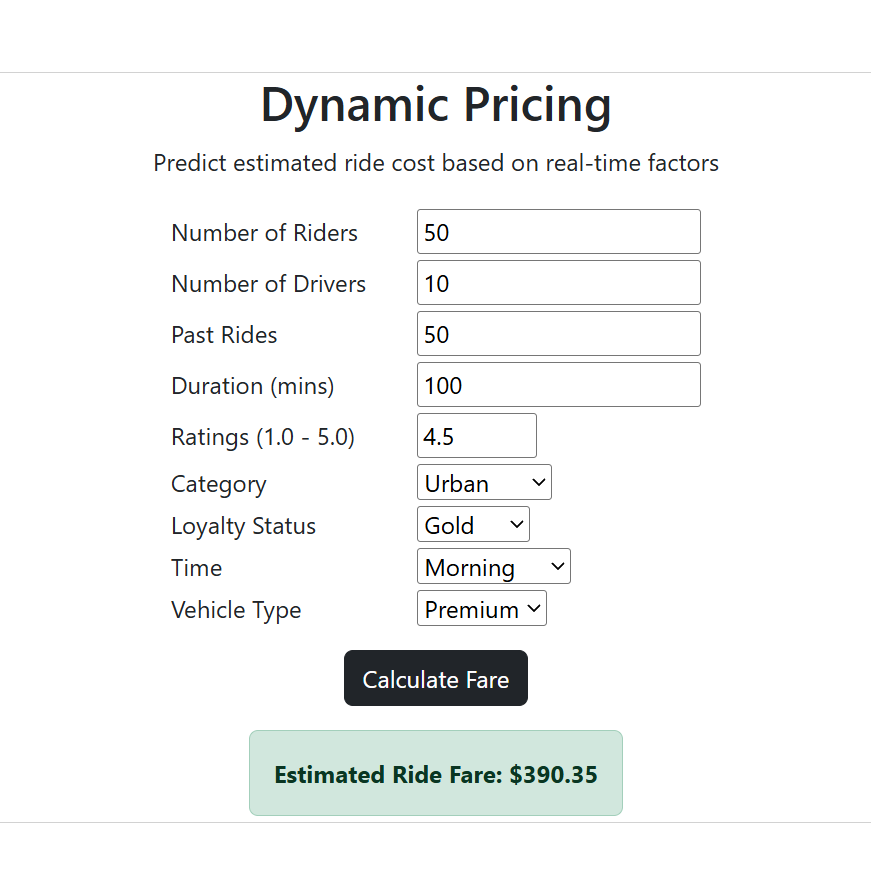

# Ride Fare Dynamic Pricing 

Problem Statement: A leading ride-sharing company currently prices rides primarily based on expected duration. The objective of this project is to implement a dynamic pricing model to increase revenue, improve fleet allocation and maintain customer retention.

Solution: An end-to-end Machine Learning project designed to build a dynamic price prediction model for a ride-sharing service. The system goes beyond basic trip duration pricing by incorporating real-time supply-demand dynamics, customer loyalty profiles, time of day, location categories, and vehicle types.



## Tech Stack
- Data Science: NumPy, Pandas, Matplotlib, Seaborn, Scikit-Learn
- Machine Learning: Gradient Boosting Regressor, Random Forest Regressor and Linear Regression.
- Deployment: HTML5, CSS3, Bootstrap, Git, GitHub and Render Platform.

## Setup Installation
```
pip install pandas numpy matplotlib seaborn scikit-learn joblib
git clone https://github.com/ujjwalkumar14b/Dynamic_Pricing.git
cd Dynamic_Pricing
```

## Author
Ujjwal Kumar
GitHub: [https://github.com/ujjwalkumar14b](https://github.com/ujjwalkumar14b)
